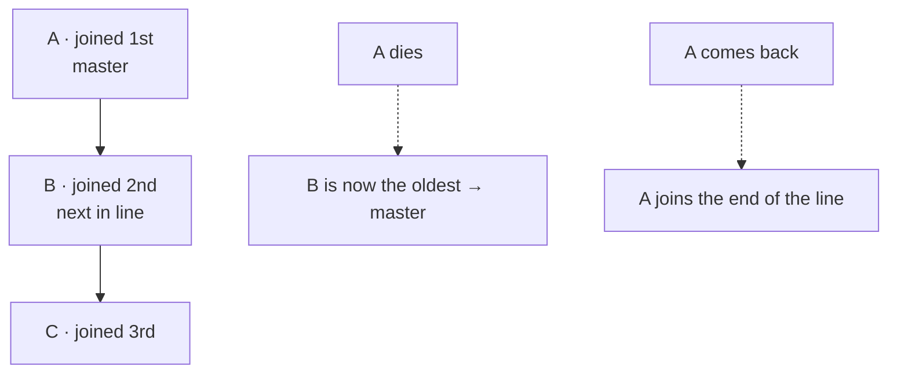

# doyen

> 🚧 **Status: planning — not usable yet.** This repository holds the design and, soon, the
> first release. The npm package `@leofdss/doyen` 0.0.1 only reserves the name.

Pick **one master** among the instances of a service, through **the database you already
run**.

You scale a service horizontally, but some work must run on only one instance at a time — a
scheduler, a consumer that owns a set of data. ZooKeeper or etcd solve this, but most teams do
not run them. doyen uses the database the team already has.

## How it works

Every instance joins a line. The **oldest live instance is the master**. When it dies, the next
in line takes over. There is no vote and no new server: the line lives in your database.



- **One API, many databases.** Adapters for Redis and MongoDB first, then PostgreSQL.
- **Three languages, one core.** The core is written in Rust; Node.js and Go use it through
  bindings.
- **A small API.** `join`, `status`, `onStatusChange` and `leave` — nothing more.

Planned API (Node.js):

```ts
import { DatabaseType, Doyen, Status } from "@leofdss/doyen";

const doyen = new Doyen();
await doyen.join({ type: DatabaseType.redis, url: "redis://localhost:6379", group: "billing-jobs" });

doyen.onStatusChange((status) => {
  if (status === Status.master) startJobs();
  else stopJobs();
});

process.on("SIGTERM", async () => {
  await doyen.leave(); // the next instance takes over at once
  process.exit(0);
});
```

> [!WARNING]
> doyen does not protect your writes. After a long pause (for example, garbage collection) or
> a Redis failover, an old master can still write for a moment. If your work cannot run twice,
> make it safe to repeat.

## Planned databases

| Database | Needs | Note |
|---|---|---|
| Redis | A Redis server, with or without replicas, or Redis Cluster | The weakest for safety: Redis can lose recent writes after a restart or a failover, so two masters can exist for a moment. |
| MongoDB | 4.2 or newer; a replica set or a sharded cluster | All writes use `w: "majority"`. With an arbiter (primary, secondary, arbiter), if one data node is down, no instance can be master until it comes back. doyen logs a warning at connect. |
| PostgreSQL | Later | |

## Why the name

The *doyen* of the diplomatic corps is the ambassador who has served longest in a country.
When they leave, the next longest-serving ambassador becomes doyen — no election. That is the
rule of this library.

## Planned releases

| Version | What | Where |
|---|---|---|
| 0.1 | Rust core + Redis and MongoDB adapters | crates.io |
| 0.2 | Node.js package | npm: `@leofdss/doyen` |
| 0.3 | Go module | `github.com/leofdss/doyen-go` |
| 0.4 | PostgreSQL adapter | all three |

## License

Licensed under either of

- Apache License, Version 2.0 ([LICENSE-APACHE](LICENSE-APACHE))
- MIT license ([LICENSE-MIT](LICENSE-MIT))

at your option.

Unless you explicitly state otherwise, any contribution intentionally submitted for inclusion
in the work by you, as defined in the Apache-2.0 license, shall be dual licensed as above,
without any additional terms or conditions.
