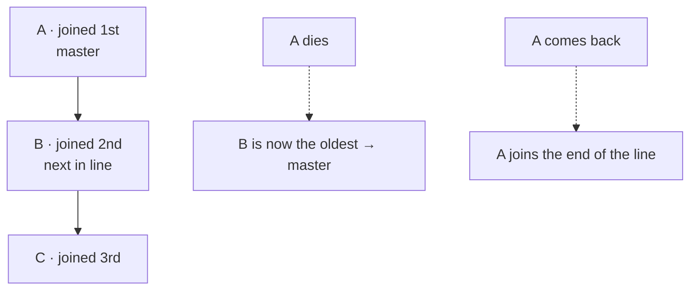

# doyen

> 🚧 **Status: planning — not usable yet.** This repository holds the design and, soon, the
> first release. The npm package `@leofdss/doyen` 0.0.1 only reserves the name.

Pick **one master** among the instances of a service, through **the database you already
run**.

You scale a service horizontally, but some work must run on only one instance at a time — a
scheduler, a consumer that owns a set of data. ZooKeeper or etcd solve this, but most teams do
not run them. doyen uses the database the team already has.

## How it works

Every instance joins a line. The **oldest live instance is the master**. When it dies, the next
in line takes over. There is no vote and no new server: the line lives in your database.



- **One API, many databases.** Adapters for Redis and MongoDB first, then PostgreSQL.
- **Three languages, one core.** The core is written in Rust; Node.js and Go use it through
  bindings.
- **A small API.** `join`, `status`, `onStatusChange`, `token` and `leave` — nothing more.
- **Fencing token.** While an instance is master, `token()` returns `(generation, number)`,
  which only grows — also after the database loses data, because the generation comes from
  the database server's clock. Send it with your writes, and your database can reject a late
  write from an old master.

Planned API (Node.js):

```ts
import { DatabaseType, Doyen, State } from "@leofdss/doyen";

const doyen = new Doyen();

doyen.onStatusChange((status) => {
  if (status.state === State.master) startJobs();
  else stopJobs();
  if (status.state === State.offline) {
    console.warn(`doyen offline: ${status.reason}`, status.error ?? "");
  }
});

await doyen.join({ type: DatabaseType.redis, url: "redis://localhost:6379", group: "billing-jobs" });

// Read the token at each write and send it with the write.
const token = doyen.token(); // null when this instance is not master
if (token) await saveInvoice(invoice, token); // see "Using the token"

process.on("SIGTERM", async () => {
  await doyen.leave(); // the next instance takes over at once
  process.exit(0);
});
```

> [!IMPORTANT]
> The token protects your data only if your database checks it: keep the highest token seen
> and reject lower ones (compare `generation` first, then `number`). Without that check, after
> a long pause (for example, garbage collection) or a Redis failover, an old master can still
> write for a moment. See [Using the token](#using-the-token).

## Status

`status()` returns `{ state }`: `master`, `slave` or `offline`. When the state is `offline`,
the status also has a `reason`, so you can find the problem, and `error`: the last database
error, when there is one (for example a wrong password).

| Reason | When | Where to look |
|---|---|---|
| `notJoined` | `join()` was not called yet, or it rejected. | Your app: call `join()`. If it rejected, its error says why. |
| `connecting` | `join()` is running, and the instance has no place in the line yet. doyen tries again after each network error. | This instance never reached the database: URL, DNS, network, firewall, or the database is not running. |
| `connectionLost` | The instance had a place, but it could not renew it in time. doyen keeps trying to renew the same place. | The database does not answer or is too slow, or the process stopped for a long time (a VM or container pause). `error` shows the last database error. |
| `reconnecting` | The place is gone (it expired, or the database lost it). doyen joins again, at the end of the line. | After `connectionLost`: the problem lasted longer than `timeoutMs`. Directly from `master` or `slave`: the database lost data (a Redis restart without persistence, a failover). If it stays, `error` says why the joins fail. |
| `left` | After `leave()`. | Normal stop. |

- When the database goes down, the status changes to `offline` (`connectionLost`) when the
  local lease ends: 7–9 s with the defaults. A shorter problem does not change the master.
- `onStatusChange` runs on every change, and a new reason is a change too. A failed retry
  with the same reason does not call it, even when `error` changes; `status()` always has the
  last `error`.
- After `join()` resolves, doyen never gives up: it retries every error (also a wrong
  password, which you can fix while the service runs).
- The reasons are strings, so a log line shows `connectionLost`, not a number.
- **Warnings.** doyen warns once, at connect, about a setup that works but has a known risk:
  in Node.js with `process.emitWarning` (codes `DOYEN_MONGODB_ARBITER` and
  `DOYEN_REDIS_EVICTION`), in Rust with `tracing`, in Go with `slog`.

## Using the token

Your database keeps the highest token it has seen, and each write checks it first. Example
with PostgreSQL and the `pg` package — one fence row per group:

```sql
CREATE TABLE doyen_fence (
  grp text PRIMARY KEY,
  gen bigint NOT NULL,
  num bigint NOT NULL
);
INSERT INTO doyen_fence VALUES ('billing-jobs', 0, 0);
```

```ts
import pg from "pg";
import type { Token } from "@leofdss/doyen";

const pool = new pg.Pool();

async function saveInvoice(invoice: Invoice, token: Token): Promise<boolean> {
  const client = await pool.connect();
  try {
    await client.query("BEGIN");

    // Keep the highest token. An older token changes no row.
    const fence = await client.query(
      `UPDATE doyen_fence SET gen = $2, num = $3
        WHERE grp = $1 AND (gen, num) <= ($2::bigint, $3::bigint)`,
      ["billing-jobs", token.generation, token.number],
    );
    if (fence.rowCount === 0) {
      await client.query("ROLLBACK");
      return false; // a newer master exists: this write is late
    }

    await client.query("UPDATE invoices SET status = $2 WHERE id = $1", [
      invoice.id,
      invoice.status,
    ]);
    await client.query("COMMIT");
    return true;
  } catch (err) {
    await client.query("ROLLBACK");
    throw err;
  } finally {
    client.release();
  }
}
```

Why it works:

- `(gen, num) <= (…)` compares `gen` first, then `num` — the order of the token.
- The `UPDATE` locks the fence row until `COMMIT`, so the writes of two masters run one after
  the other, never at the same time.
- After the first write of the new master, every write of the old master changes no fence
  row and is rolled back.

Any database with transactions can do the same: in one transaction, update the fence record
only if the token is not lower, then write your data.

After you restore doyen's MongoDB data from a backup, delete the group's document in doyen's
collection (default `doyen`): doyen creates it again with a new generation. Else the token
can go back, and the fence rejects every write of the new master.

## Timeout and renew interval

You choose them in the config. The right values depend on your infrastructure, so test them
there.

| Setting | Default | What it does |
|---|---|---|
| `timeoutMs` | `10000` (10 s) | An instance that does not renew for this long leaves the line. |
| `renewIntervalMs` | `2000` (2 s) | How often each instance renews its place. |

With the defaults, the next instance takes over 8–12 s after the master crashes (at once
after `leave()`), and a database problem shorter than about 7 s does not change the master.

- A **shorter timeout** gives a faster takeover, but more master changes when the network or
  the database is slow for a moment.
- Keep `timeoutMs` at **3 to 5 times** `renewIntervalMs`. `join` rejects a config where
  `timeoutMs` is less than 3 times `renewIntervalMs`: with less, a slow but good renew can
  arrive after the local lease ended, and the status goes `offline` for nothing.
- **Test a database failover.** If it takes longer than `timeoutMs`, there is no master
  during the failover. That is safe, but your master work stops for that time.

## Planned databases

| Database | Needs | Note |
|---|---|---|
| Redis | 6.2 or newer; one server, Redis Cluster or Sentinel; no eviction of doyen's keys | The weakest for safety: Redis can lose recent writes after a restart or a failover, so two masters can exist for a moment. The token helps your database reject the old one. |
| MongoDB | 4.2 or newer; a replica set or a sharded cluster | All writes use `w: "majority"`. With an arbiter (primary, secondary, arbiter), if one data node is down, no instance can be master until it comes back. doyen warns at connect (`DOYEN_MONGODB_ARBITER`). |
| PostgreSQL | Later | |

- **Redis URL:** `redis://` or `rediss://` (TLS) for one server or Redis Cluster (doyen finds
  out which); `redis+sentinel://[user:pass@]host1:26379,host2:26379/<master name>` for
  Sentinel. With one URL and no Sentinel, doyen follows a failover only if the name moves to
  the new primary (for example the primary endpoint of a managed service).
- **Redis keys:** they start with `doyen:{group}:`, so a `group` cannot contain `{` or `}`.
- **Redis memory:** doyen's keys must stay. With `maxmemory` set, an `allkeys-*` policy is
  refused (Redis could delete the counters), and a `volatile-*` policy gives the warning
  `DOYEN_REDIS_EVICTION` (Redis could delete a member's place: a master change). Best:
  `noeviction`.
- **MongoDB database:** the one in the URL path, else `doyen`. The settings `database` and
  `collection` (default `doyen`) change it.

## Why the name

The *doyen* of the diplomatic corps is the ambassador who has served longest in a country.
When they leave, the next longest-serving ambassador becomes doyen — no election. That is the
rule of this library.

## Planned releases

| Version | What | Where |
|---|---|---|
| 0.1 | Rust core + Redis and MongoDB adapters | crates.io |
| 0.2 | Node.js package | npm: `@leofdss/doyen` |
| 0.3 | Go module | `github.com/leofdss/doyen-go` |
| 0.4 | PostgreSQL adapter | all three |

## License

Licensed under either of

- Apache License, Version 2.0 ([LICENSE-APACHE](LICENSE-APACHE))
- MIT license ([LICENSE-MIT](LICENSE-MIT))

at your option.

Unless you explicitly state otherwise, any contribution intentionally submitted for inclusion
in the work by you, as defined in the Apache-2.0 license, shall be dual licensed as above,
without any additional terms or conditions.
