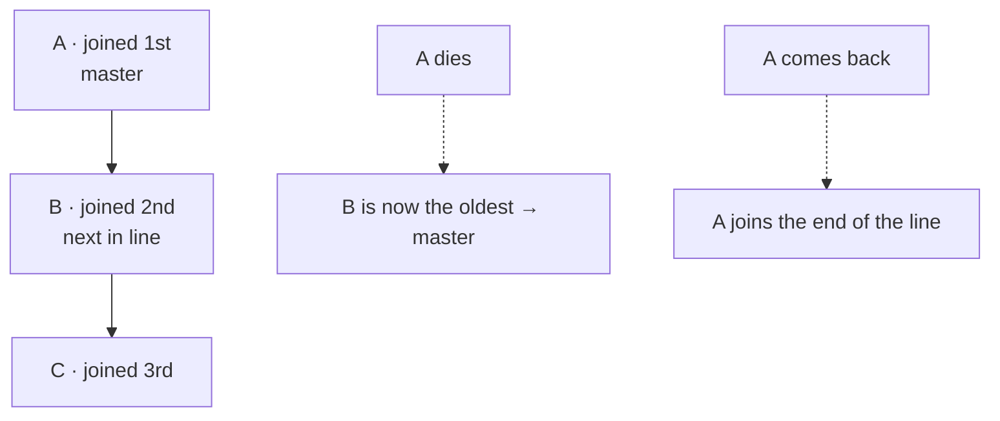

# doyen

> 🚧 **Status: planning — not usable yet.** This repository holds the design and, soon, the
> first release. The npm package `doyen` 0.0.1 only reserves the name.

Pick **one master** among the instances of a service, through **the database you already
run**.

You scale a service horizontally, but some work must run on only one instance at a time — a
scheduler, a consumer that owns a set of data. ZooKeeper or etcd solve this, but most teams do
not run them. doyen uses the database the team already has.

## How it works

Every instance joins a line. The **oldest live instance is the master**. When it dies, the next
in line takes over. There is no vote and no new server: the line lives in your database.



- **One API, many databases.** Adapters for Redis (first), then PostgreSQL and MongoDB.
- **Three languages, one core.** The core is written in Rust; Node.js and Go use it through
  bindings.
- **Fencing token.** Each master gets a token, `(generation, number)`, that only grows. Send it
  with your writes, and your database can reject a late write from an old master.

## Why the name

The _doyen_ of the diplomatic corps is the ambassador who has served longest in a country.
When they leave, the next longest-serving ambassador becomes doyen — no election. That is the
rule of this library.

## Planned releases

| Version | What                      | Where                         |
| ------- | ------------------------- | ----------------------------- |
| 0.1     | Rust core + Redis adapter | crates.io                     |
| 0.2     | Node.js package           | npm                           |
| 0.3     | Go module                 | `github.com/leofdss/doyen-go` |
| 0.4     | PostgreSQL adapter        | all three                     |

## Node.js binding (development)

The native addon requires Rust 1.88+ and Node.js 22.13+ (or Node.js 24+). Run the
commands from the repository root to install the local build tools, compile a debug
addon, and run the tests:

```bash
npm ci
npm run build:debug
npm test
```

Use `npm run build` for an optimized release build and `npm run pack` to create
`dist/packages/doyen/doyen-0.1.0.tgz`. Run `npm run test:nestjs` to validate that
exact tarball in the NestJS consumer.

The NAPI-RS CLI generates the `index.js` loader, the `index.d.ts` declarations, and a
platform-specific `.node` binary. Do not edit the generated loader or declarations
manually. Import the addon through `index.js`.

> **WSL:** keep the checkout on the Linux filesystem (for example, under `$HOME`),
> not under `/mnt/*`. The NAPI-RS CLI can fail its atomic artifact replacement on
> Windows-mounted filesystems. Alternatively, run `npm run test:container` from the
> repository root to validate the project in a native container filesystem.

The current exports preserve the original example responses:

- `raiz(): string` returns `Olá, mundo!`.
- `saudacao(nome: string): string` returns `Olá, <nome>!`.

## License

Licensed under either of

- Apache License, Version 2.0 ([LICENSE-APACHE](LICENSE-APACHE))
- MIT license ([LICENSE-MIT](LICENSE-MIT))

at your option.

Unless you explicitly state otherwise, any contribution intentionally submitted for inclusion
in the work by you, as defined in the Apache-2.0 license, shall be dual licensed as above,
without any additional terms or conditions.
